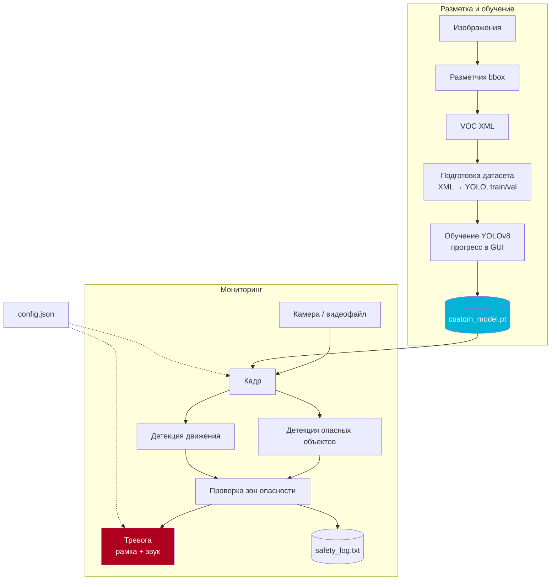

# Sentinel Vision

**Система интеллектуального видеонаблюдения: обучение собственного детектора, разметка и тревоги в реальном времени**


Прикладная система физической безопасности: смотрит в камеру, распознаёт опасные объекты, замечает движение и вход в запретные зоны, поднимает визуальную и звуковую тревогу и ведёт журнал событий. Своя модель — потому что стандартный набор классов COCO не покрывает нужные объекты.

> Ранее репозиторий назывался `Barahlo`.

---

## Возможности

**Мониторинг в реальном времени**
- Детекция объектов обученной моделью YOLOv8 и базовой `yolov8n`
- Детекция движения без нейросети — дешёвый резервный канал
- Зоны опасности: тревога, если объект попал в заданную область кадра
- Список опасных классов настраивается (`нож`, `оружие`, `огонь` и любые свои)
- Тревога двух типов: красная рамка на кадре и звуковой сигнал
- Журнал событий с уровнями логирования

**Свой детектор**
- Встроенный разметчик: рисуете bbox мышью прямо в приложении
- Автоматическая подготовка датасета: VOC XML → формат YOLO, разбивка train/val
- Обучение YOLOv8 из интерфейса с прогресс-баром
- Дообучение от последнего чекпоинта (`last.pt`) вместо обучения с нуля

## Архитектура



## Быстрый старт

```bash
git clone https://github.com/lorzik/Barahlo.git
cd Barahlo
python -m venv .venv

# Windows
.venv\Scripts\activate
# Linux / macOS
source .venv/bin/activate

pip install -r requirements.txt
```

Запуск:

```bash
python full_model.py     # полная версия: базовая модель + своя + детекция движения
# или
python single_model.py   # упрощённая версия
```

Базовая модель `yolov8n.pt` скачается автоматически при первом запуске. Своя модель — `custom_model.pt` — появится после обучения; до этого работает только базовый детектор.

## Настройка

Все параметры читаются из `config.json`:

| Параметр | Смысл | Пример |
|---|---|---|
| `video_source` | `0` — веб-камера, либо путь к видеофайлу | `0` |
| `danger_objects` | Классы, на которые поднимается тревога | `["knife", "gun", "fire"]` |
| `danger_zones` | Прямоугольные зоны кадра как запретные области | `[]` |
| `motion_detection` | Включить детекцию движения | `true` |
| `thermal_detection` | Режим тепловизора | `false` |
| `alert_types` | Типы тревоги | `["visual", "audio"]` |
| `alert_sound` | Звук тревоги | `alert.wav` |
| `visual_alert_color` | Цвет рамки в BGR | `[0, 0, 255]` |
| `min_confidence` | Порог уверенности детекции | `0.7` |

## Как обучить свою модель

1. **Соберите изображения** — кадры с камеры в одной папке.
2. **Разметьте** — откройте окно разметки в приложении, обведите объекты рамками и задайте имена классов. Результат сохраняется в VOC XML.
3. **Подготовьте датасет** — приложение конвертирует XML в формат YOLO, разложит файлы по `train`/`val` и создаст `classes.names` и YAML-конфиг.
4. **Обучите** — выберите «обучение с нуля» или «дообучение» и запустите. Прогресс виден в окне.
5. **Проверьте** — лучший чекпоинт копируется в `custom_model.pt` и подхватывается мониторингом.

## Структура проекта

```
sentinel-vision/
├── full_model.py     # полная версия: базовая и своя модели, детекция движения
├── single_model.py   # упрощённая версия
├── config.json       # параметры мониторинга
├── coco.names        # 80 классов COCO
├── alert.wav         # звук тревоги
├── safety_log.txt    # журнал событий
└── security_icon.ico # иконка приложения
```

## Ограничения

- **Требует GPU для обучения в разумное время.** На CPU дообучение даже маленькой модели идёт часами.
- **Базовая модель путает похожие классы** — `нож` на COCO отсутствует вовсе, поэтому нужен свой детектор. Без него детекция опасных объектов работает только по тем классам, что есть в COCO.
- **`thermal_detection` пока не реализован** — параметр есть в конфиге, но ветка детекции по тепловизору не подключена.
- **Аудио и видео пишутся в локальные файлы** — отдельного хранилища событий нет.


## Лицензия

Да делайте что хотите
